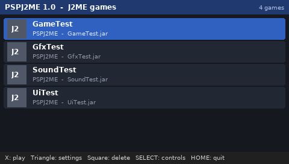
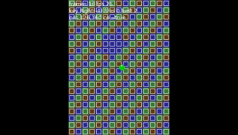
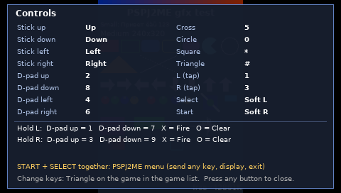

# PSPJ2ME: J2ME games on your PSP

**PSPJ2ME** runs Java ME (J2ME) mobile phone games, the `.jar` games from mid-2000s phones,
natively on a **Sony PSP**. It is a from-scratch emulator: its own Java virtual machine, its own
implementation of the phone APIs (CLDC 1.1 / MIDP 2.0 + Nokia UI), software rendering, a MIDI
synthesizer, and a PSP front-end with a game browser.

<p align="center">
  
  
</p>

## Download

1. Open the **[Releases page](https://github.com/alexletho/pspj2me/releases)** and download
   **`PSPJ2ME-x.y.zip`** from the latest release.
2. Unzip it to the **root of your PSP memory stick**. You'll get
   `PSP/GAME/PSPJ2ME/EBOOT.PBP` and an empty `PSP/GAME/PSPJ2ME/games/` folder.
3. Copy your games (`.jar`, optionally with the matching `.jad`) into
   **`PSP/GAME/PSPJ2ME/games/`** (or into `J2ME/` at the root of the memory stick).
4. On the PSP: **Game → Memory Stick → PSPJ2ME**, pick a game, press **X**.

**Requirements:** a PSP with custom firmware or a HEN that runs homebrew (any model; PSP-2000/3000/Go
get ~40 MB of memory for games, PSP-1000 ~10 MB). No games are included; use games you own.

**Tested on:** a PSP-3004 with firmware 6.61 and the PRO-C custom firmware.

> Tip: copy files with a card reader or USB mode, and eject the memory stick properly before
> removing it. macOS's hidden `._` files are ignored automatically.

## Controls

Default layout. Every phone key is reachable; change it per game with **△** on the game in the list.

| PSP                     | Phone key                            |
|-------------------------|--------------------------------------|
| Analog stick            | ↑ ↓ ← → arrow keys                   |
| D-pad                   | 2 / 8 / 4 / 6                        |
| ✕ Cross / ○ Circle      | 5 / 0                                |
| □ Square / △ Triangle   | * / #                                |
| SELECT / START          | Left / right soft key                |
| L / R                   | shift buttons (see combos below)     |
| **START + SELECT**      | PSPJ2ME menu                         |

**Shoulder combos:** hold L or R and press another button:

| Hold L + …   | Key        | Hold R + …   | Key        |
|--------------|------------|--------------|------------|
| D-pad up     | 1          | D-pad up     | 3          |
| D-pad down   | 7          | D-pad down   | 9          |
| ✕            | Fire (OK)  | ✕            | Fire (OK)  |
| ○            | Clear (C)  | ○            | Clear (C)  |

L and R alone send nothing: they pick the left or right column of the keypad, and D-pad up/down
picks the top or bottom row (1 3 / 7 9). If you prefer L and R as plain keys (1 and 3), turn
**Shoulder combos** off in that game's settings.

The **PSPJ2ME menu** (START + SELECT together) lets you send any phone key, see the controls of
the current game, change the display mode, smoothing, FPS counter and VSync, or exit back to the
game list.

<p align="center"></p>

If a .jar contains several games (compilations), ✕ asks which one to start.

**In the game list:** ✕ play · △ game settings · □ delete a game · SELECT show controls ·
START change the sort order (name, recently played, most played, recently added) · HOME quit.

## Per-game settings (△ in the game list)

* **Phone screen size**: **Auto** by default. J2ME games were released as one version per phone
  model, and PSPJ2ME works out which screen the version was made for from the file name
  (`Game_240x320.jar`, `Game_N73.jar`, `Game_K750i.jar`), the game's JAD/manifest, or its full-screen
  images. If nothing is found it uses 240×320. You can also pick a size yourself; "multiscreen" games
  adapt to any size, so for those try **480×272** (the PSP's own resolution, perfectly sharp).
* **Phone type (key codes)**: **Auto** by default. Phone makers used different key numbers for the
  arrows and soft keys; a version made for a Siemens, Motorola or LG phone needs that phone's numbers
  or it won't react to some keys. Auto recognises the maker from the file name or from the phone
  APIs the game uses; otherwise it uses Nokia / Sony Ericsson / Samsung numbers.
* **Display mode**: **Fit** (keeps the shape, black bars at the sides) or **Stretch** (fills the screen).
* **Smooth scaling**: bilinear filtering on/off.
* **Speed-up**: many J2ME games cap their own frame rate. This shortens the game's sleeps
  (x1.3 / x2 / x3) for a higher frame rate. In games that advance a fixed step per frame, this
  also makes the game itself run faster.
* **Show FPS** and **VSync**.
* **Shoulder combos** on/off (see Controls).
* **Button mapping** for every PSP button, with "reset to defaults".

Settings are stored per game in `PSP/GAME/PSPJ2ME/data/`; game saves (RMS) are kept in
`data/rms/`. Deleting a game (□) can keep or remove its saves.

## Compatibility

Supported:

* CLDC 1.1, MIDP 2.0: `Canvas`, `GameCanvas`, sprites, tiled layers, `Form`/`List`/`Alert`/`TextBox`
  (text entry uses the PSP's on-screen keyboard), record stores (saves)
* Nokia UI API (`FullCanvas`, `DirectGraphics`, `DirectUtils`, `Sound`)
* PNG and baseline JPEG images
* Sound via MMAPI: **MIDI music** (built-in synthesizer), **MP3**, **AMR** (narrowband),
  **WAV** (PCM and IMA ADPCM), tone sequences;
  pause/resume, seeking, looping, stop times, volume, tempo/rate and pitch, `MIDIControl` and the
  `device://midi` / `device://tone` players
* Nokia `Sound`: WAV, Nokia ringtones (`FORMAT_TONE`) and beeps
* Latin and Cyrillic text in the built-in fonts

PSPJ2ME is made for **2D games from keypad ("button") phones**. These are **not supported and not
planned**:

* 3D games (M3G / JSR-184, MascotCapsule)
* Touch-screen-only games (games made for touch phones that can't be played with keys)
* Bluetooth and network features: multiplayer, online scores, "buy the full version" by SMS/web.
  Games are told there is no connection and carry on without it.
* A JIT compiler: most 2D games already run at their intended speed; very heavy games may run
  slower than on the original phone

Not supported at the moment (games run, the feature is just missing):

* AMR-WB (wideband) and Yamaha SMAF (`.mmf`) sound, and video: the game plays without that sound
* Extra APIs of other phone makers (Siemens, Samsung, Motorola, …): such games stop with a message
  that names the missing API. Please report them, so the most common ones can be added.

## Troubleshooting

PSPJ2ME writes `PSP/GAME/PSPJ2ME/pspj2me.log` on every start; the previous run is kept as
`pspj2me.prev.log` (each capped at 256 KB). It lists the games launched, their settings, missing
classes, Java exceptions, and a thread dump if a game stops drawing. **When reporting a problem,
please [open an issue](https://github.com/alexletho/pspj2me/issues/new/choose) using the "Game doesn't
work" form and attach both log files.** Games that work well can be reported with the "Game works" form. Enable **Show FPS** for a game
to also log performance details.

* *Game list is empty:* the `.jar` files must be directly inside `PSP/GAME/PSPJ2ME/games/`
  (not in sub-folders). Files that aren't valid `.jar` archives are skipped and listed in the log.
* *"Could not start this game" / "The game stopped working":* PSPJ2ME tells you why in plain words,
  for example that the game needs 3D graphics, that the .jar is damaged, or that the game crashed.
  If a game freezes after an error, PSPJ2ME notices and offers to go back to the game list. The log
  has the technical details; please report such games with the "Game doesn't work" form.
* *Text too small / screen cut off:* change the phone screen size for that game (see above).
* *Game ignores the OK key:* some games only react to the phone's dedicated Fire key. Map ✕ to
  "Fire" in the game's settings or send Fire from the START + SELECT menu.

## Building from source

Requirements: GCC, JDK 8+ (`javac`), Python 3, and the [pspdev](https://github.com/pspdev/pspdev)
toolchain (`psp-gcc` and `psp-config` in `PATH`). Pillow is only needed to regenerate fonts.

```bash
make test     # host build + VM and MIDlet tests (headless, on Linux)
make dist     # EBOOT.PBP and PSPJ2ME-<version>.zip
```

Every push is built and tested by GitHub Actions. Publishing a GitHub release builds the
package and attaches it to the release automatically.

The host runner `build/j2me_host` runs the same VM and phone APIs on Linux (no window) and is used
for testing: `./build/j2me_host game.jar --quit 5000 --final shot.ppm`, scripted keys with
`--keys "1000:fire,1500:down"`. `tests/ppsspp_run.sh` runs the EBOOT inside PPSSPP's headless
build using a developer `autostart.txt` (only honoured inside PPSSPP; a real PSP ignores it).

### How it works

```
src/vm/        Java VM: class loader, interpreter (threaded dispatch + quickening),
               mark-sweep GC, green threads and monitors, zip reader
src/native/    java.lang natives; MIDP natives (graphics, images, fonts, events, RMS, launch)
src/gfx/       software rasterizer, PNG and JPEG decoders, bitmap fonts
src/audio/     mixer: WAV, MIDI wavetable synthesizer, tone sequences, MP3 (minimp3), AMR (opencore-amr)
src/platform/  PSP layer (GU video, input, game list, on-screen keyboard, audio) and Linux host layer
classlib/src/  the Java class library (CLDC, MIDP, Nokia UI), compiled into the EBOOT
tests/         VM test suite, test MIDlets, audio/JPEG tests
```

## License

PSPJ2ME is free software: you can redistribute it and/or modify it under the terms of the
**GNU General Public License v3.0 or later**. See [LICENSE](LICENSE). The built-in font is
derived from DejaVu Sans; MP3 and AMR decoding use minimp3 (public domain) and opencore-amr
(Apache 2.0); see [THIRD_PARTY.md](THIRD_PARTY.md).

PSPJ2ME is an independent project. It is not affiliated with, or endorsed by, Oracle, Sony,
Nokia or any game publisher. "Java", "J2ME" and "Java ME" are trademarks of Oracle and/or its
affiliates and are used here only to describe compatibility;
"PSP" and "PlayStation" are trademarks of Sony Interactive Entertainment. No games are included.
